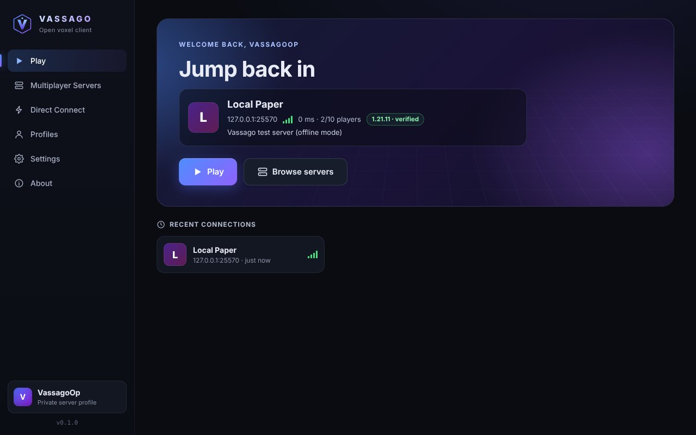
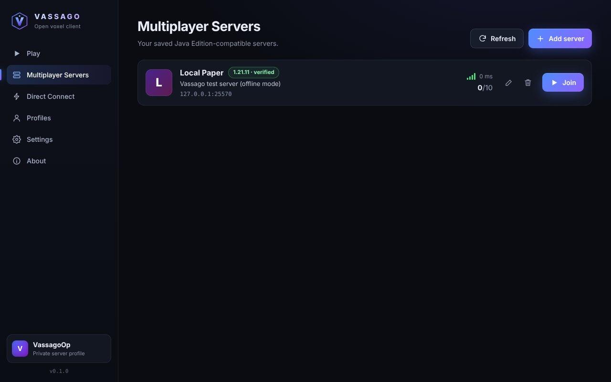
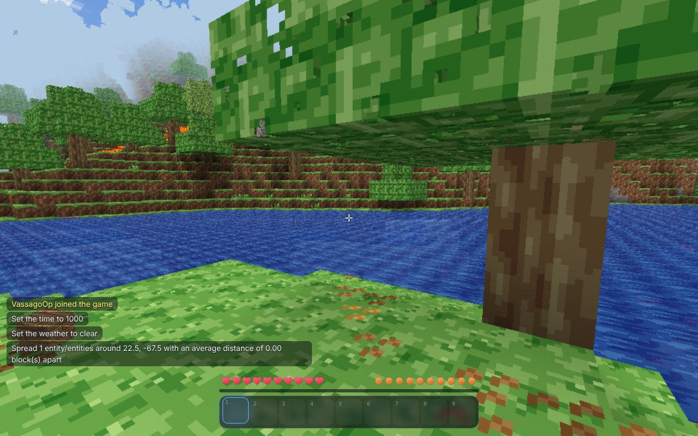
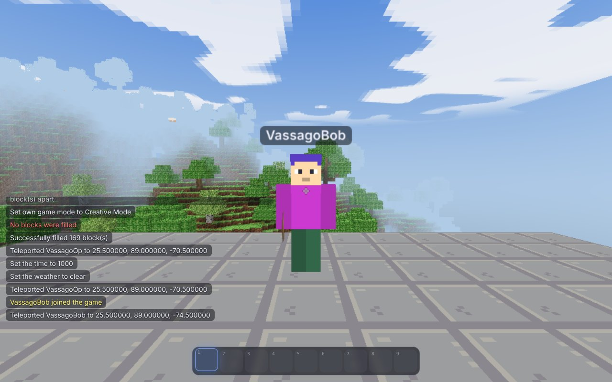
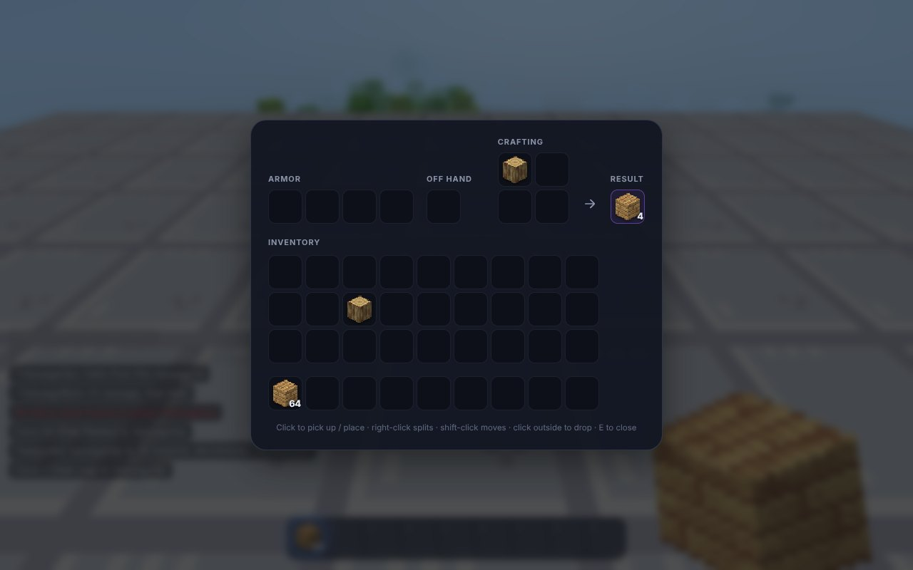
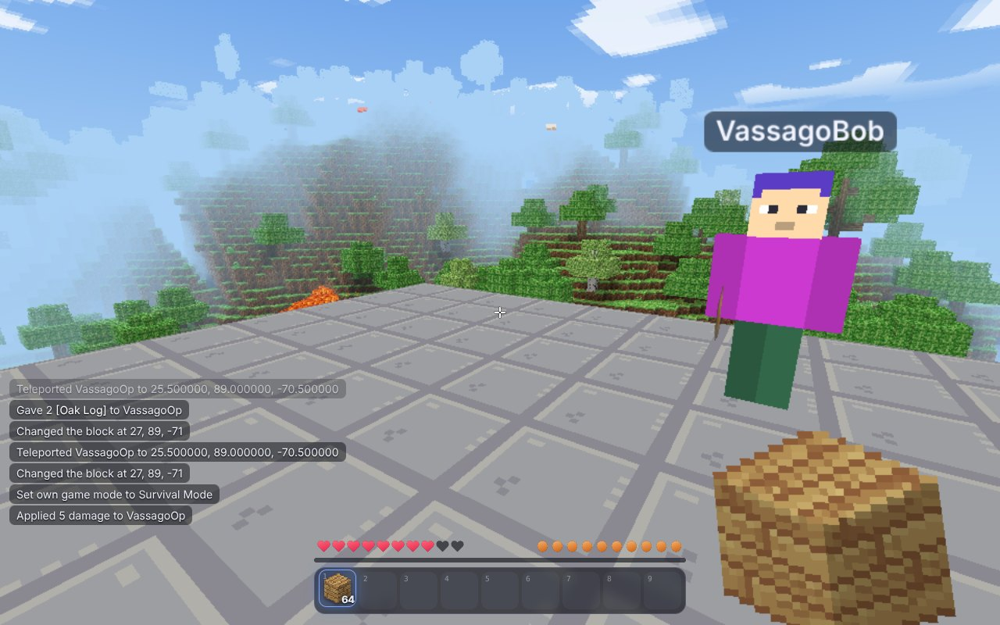

# Vassago

**A free, independent, open-source desktop client for Minecraft: Java Edition-compatible servers.**

Vassago is a complete graphical game client — launcher, 3D world renderer, multiplayer gameplay — written
from scratch on top of the open-source [PrismarineJS](https://github.com/PrismarineJS) protocol stack.
It does not need, download or contain the original game: every texture, icon and model is generated by
Vassago's own procedural art engine.

> Not affiliated with, endorsed by, or connected to Mojang Studios or Microsoft.
> "Minecraft" is a trademark of Mojang Synergies AB.

* **Private Server Mode** — pick a display name and join servers whose owner has explicitly enabled
  offline mode. No Microsoft sign-in involved.
* **Official Account Mode** — Microsoft device-code sign-in for online-mode servers. Ownership is
  checked by Microsoft/Mojang; Vassago never sees your password and never bypasses server authentication.
* Installers are built for Windows, macOS (Apple Silicon + Intel) and Linux; so far only the Linux
  build has actually been run. MIT licensed. No telemetry, no ads, no fees.

| | |
|---|---|
|  |  |
|  |  |
|  |  |

_Screenshots are captured by the automated end-to-end test (software rendering, PaperMC 1.21.11)._

See [DEVELOPMENT_STATUS.md](DEVELOPMENT_STATUS.md) for exactly what is verified, what is partial and
what is missing — nothing is claimed that has not been tested.

## Quick start (from source)

```bash
npm ci
npm start
```

Requires Node.js 20+. The first `npm start` also checks that the Electron runtime was downloaded
and fetches it if not.

<details>
<summary>Troubleshooting: "Electron failed to install correctly"</summary>

Electron's runtime is downloaded by an npm post-install step. If that step was skipped (for example
`ignore-scripts` is set, or your package manager blocks dependency install scripts) or the download
was interrupted, the runtime is missing. `npm start` now repairs this by itself; to do it by hand:

```bash
node scripts/ensure-electron.mjs
```

Behind a proxy, set `HTTPS_PROXY`; to use a mirror, set
`ELECTRON_MIRROR=https://npmmirror.com/mirrors/electron/` before running it.

</details>

To try it against a local server:

```bash
npm run test-server -- --accept-eula
```

This downloads PaperMC and starts an offline-mode server bound to `127.0.0.1:25570` (Java 21 required;
`--accept-eula` confirms you agree to the [Minecraft EULA](https://aka.ms/MinecraftEULA)). Then in
Vassago: **Direct Connect → `127.0.0.1:25570`**.

Installers: `npm run dist:linux`, `npm run dist:win`, `npm run dist:mac` — see
[docs/PACKAGING.md](docs/PACKAGING.md) for prerequisites and code-signing.

## Controls

| | |
|---|---|
| `W A S D` | Move |
| `Space` | Jump — double-tap to toggle flying in creative |
| `Shift` | Sneak / descend |
| `Ctrl` or double-tap `W` | Sprint |
| Left mouse | Break block / attack |
| Right mouse | Place block / use item / open container |
| Middle mouse | Pick block (from hotbar) |
| `1`–`9`, mouse wheel | Hotbar slot |
| `E` | Inventory and 2×2 crafting |
| `Q` (`Ctrl+Q`) | Drop item (stack) |
| `T`, `/` | Chat, command |
| `Tab` | Player list |
| `F1` / `F2` / `F3` / `F11` | Hide HUD / screenshot / debug overlay / fullscreen |
| `Esc` | Pause menu |

## Server owners: offline mode is not authentication

Offline-mode servers accept any username from anyone who can reach them. If you run one:

* keep it on a LAN / VPN, or restrict it with a firewall or allow-list;
* use a login/auth plugin (e.g. an AuthMe-style plugin), or put the server behind a trusted
  authenticating proxy (Velocity/BungeeCord with modern forwarding) so backend servers are never
  reachable directly;
* never expose an unprotected offline-mode server to the public internet.

`scripts/test-server.mjs` binds to loopback only for this reason.

## Development

```bash
npm run typecheck         # TypeScript
npm test                  # unit tests (mesher, registry, raycast, art, config)
MC_EULA=true npm run test:integration   # real Paper servers: offline + online mode
xvfb-run -a npm run test:e2e            # Electron end-to-end against a real server (Linux)
```

* [docs/ARCHITECTURE.md](docs/ARCHITECTURE.md) — technology decision, process model, version adapter
* [docs/PACKAGING.md](docs/PACKAGING.md) — builds, installers, signing
* [docs/TESTING.md](docs/TESTING.md) — test environment and server profiles

## License

[MIT](LICENSE). Third-party components keep their own licenses (PrismarineJS: MIT / BSD-3-Clause,
three.js: MIT, React: MIT, Electron: MIT).
